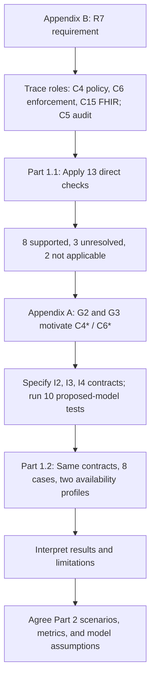

# BC–SSI architecture validation — Part 1 → Part 2 handoff

**One-sentence aim:** Use R7 (need-to-know access) as a pilot to trace a healthcare requirement to components, check what the published architecture specifies, test a small proposed logical contract, and compare baseline/refined variations **under explicit assumptions**.

## Simple research flow



**I2**: C4–C6 obligation meaning and safe failure. **I3**: C6–C15 authorization-scope coordination. **I4**: restrictions preserved until final data release.

## Three Part 1 results 

| Result | Question | Main evidence | Conclusion |
|---|---|---|---|
| **1 — Documentary R7 coverage (1.1)** | Are behaviour, interface and relevant state responsibilities sufficiently specified? | `evidence/r7_criterion_derivation.md` and `results/reference_requirement_coverage.csv` | Baseline and ATAM-only C4*+C6*: **8 supported, 3 unresolved, 2 N/A** (13 direct checks); **undetermined**, not failed |
| **2 — Proposed contracts** | Can the selected missing I2–I4 coordination rules work in a logical model? | `test_proposed_contracts.py` + three `proposed_*_test_results.csv` files | **10/10 selected tests pass**; the separate proposed logical design scores **11 supported, 0 unresolved, 2 N/A** only within selected direct criteria |
| **3 — Controlled variants (1.2)** | Do C4*/C6* improve selected outcomes when identical contracts are held fixed? | `compare_r7_controlled.py` and `results/r7_controlled_comparison.md` | Shared availability: baseline **8/8**, combined refined **8/8**. Restrictive ATAM-informed sensitivity assumption: baseline **2/8**, refined **8/8** |

**Important distinction:** The **8/3/2 are documentary *criteria***, the **10/10 are proposed contract *tests***, and the **8/8 are variation *cases***. Do not merge them into one score. The controlled comparator **reuses** the original variation runner; it is **not** an independent second experiment.

## Interpretation and limitations 

- **G2**: Appendix A reports no *dedicated* C4.4 Obligation Handler. It does **not** prove baseline C4 cannot prepare obligations.
- **G3**: Appendix A reports C6.6 minimization enforcement not operationalized at gateway instances. It is an ATAM-derived architectural observation, **not** a measurement of a running baseline deployment.
- The shared-availability profile assumes working preparation/enforcement in **both** architectures. The restricted profile assumes those *baseline* mechanisms are unavailable and refined mechanisms available. These are **sensitivity assumptions**, not measured uptime or fault rates.
- Adding named C4*/C6* does **not** automatically resolve I2/I3/I4; explicit proposed contracts do. Audit C5/I5 remains a **separate unresolved supplementary assessment**. Tests are synthetic; no deployed gateway or real FHIR service is demonstrated.

## Keep the folder structure; do not delete the older code

```text
part1_architecture_validation/
  README.md                           <-- START HERE
  docs/
    PART1_ONE_PAGE_SUMMARY.md         <-- Part 1 on one page
    R7_CHECKS_AND_EVIDENCE_GUIDE.md   <-- how 1.1 and 1.2 are done
    COLLABORATOR_HANDOFF.md           <-- Part 2 planning (this page)
  evidence/
    r7_criterion_derivation.md        <-- why each criterion exists
    r7_criterion_derivation.csv       <-- the same table, machine-readable
    Appendix_A_corrected.docx
    RequirementsAppendixB-refined.docx
  models/
    requirements.json                 <-- what R7 needs; names no component
    flows.json                        <-- who interacts with whom
    components/C*.json                <-- one file per component (Table A-0)
    capability_mappings.json          <-- the claims, each with a citation
    r7_reference_assessment.json      <-- the 16 checks and their verdicts
    refined_variations.json           <-- what C4* and C6* change
    proposed_contracts.json           <-- the proposed I2 payload and tests
  validate_architecture.py            <-- structural / traceability checks
  assess_reference_coverage.py        <-- documentary R7 verdicts  (PRIMARY 1.1)
  test_proposed_contracts.py          <-- I2-I4 proposed logical tests
  run_r7_variation_experiment.py      <-- experiment engine
  assess_variations.py                <-- variation definitions / ATAM trace
  compare_r7_controlled.py            <-- controlled comparison  (PRIMARY 1.2)
  build_r7_main_comparison.py         <-- reporting only
  results/                            <-- generated evidence
```

**Reading order:** (1) this page → (2) `evidence/r7_criterion_derivation.md` → (3) `results/r7_main_component_requirement_comparison.md` → (4) `results/r7_controlled_comparison.md`. Consult detailed CSVs and appendices to audit particular claims.

**Paper focus:** One R7 criterion-derivation/coverage table; one G2/G3-to-refinement rationale; one controlled two-profile results table; a short note on 10 passing proposed-model tests and clear limits. Keep raw CSV rows, repeated old summary reports and code listings **in the repository**, not as separate main-paper experiments.

## Reproduce from repository root

Then run in this order:

```bash
python part1_architecture_validation/validate_architecture.py
python part1_architecture_validation/test_proposed_contracts.py
python part1_architecture_validation/run_r7_variation_experiment.py
python part1_architecture_validation/assess_variations.py
python part1_architecture_validation/assess_reference_coverage.py
python part1_architecture_validation/compare_r7_controlled.py
python part1_architecture_validation/build_r7_main_comparison.py
```

**Checklist before Part 2:**
- [ ] Agree that R7 is a *pilot*, not full R1–R16 validation.
- [ ] Agree which conclusions are documentary evidence, tested proposed rules, and model assumptions.
- [ ] Confirm both availability profiles and the baseline/refined comparison are acceptable.
- [ ] Select Part 2 healthcare scenario(s), mapped requirement(s), gaps, baseline/refined model changes and measurable outcomes **before** adding new code.
- [ ] If Part 2 uses PoC/DES, treat the Part 1 deterministic R7 checks as functional evidence, **not** latency, reliability, or DES measurements.

**Part 2 bridge (illustrative only):** select a scenario → link its requirement to components and ATAM gaps → specify baseline/refined behaviours and uncertainties → choose reproducible metrics → run PoC/DES or other suitable evaluation → report improvement *and* limitations. Do not assume the Part 1 R7 results generalize to all 16 requirements or all 15 scenarios.
