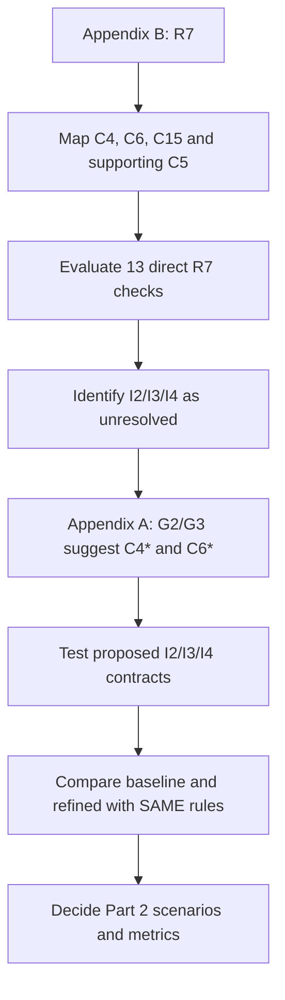

# BC–SSI healthcare architecture — Part 1 at a glance

**Purpose:** Use **R7 (need-to-know access)** as a pilot to evaluate (1.1) requirement–component coverage and (1.2) baseline/refined variations, then decide what to evaluate in Part 2.

| Evidence | What we found | Meaning |
|---|---|---|
| **1.1 Documentary coverage** | Baseline and ATAM-only refinements: **8 supported, 3 unresolved, 2 not applicable** | R7 coverage **undetermined**, not proven failure |
| **Proposed I2–I4 contracts** | **10/10** selected logical tests passed | Proposed design supports **11/11 applicable direct criteria**; not a tested real gateway |
| **1.2 Controlled comparison** | With both mechanisms assumed available: **8/8 baseline = 8/8 refined** | Refinement names alone do not improve the selected model |
| **Sensitivity scenario** | If baseline preparation/enforcement are **assumed unavailable**: baseline **2/8**, refined **8/8** | **Conditional** advantage only; assumptions are **not** measured outages |

**Key terms:** C4 prepares policy obligations; C6 enforces restrictions; C15 supports scoped FHIR data. G2 motivates dedicated C4.4 obligation handling; G3 motivates operationalizing C6.6 minimization. I2 = common obligation semantics; I3 = shared authorized scope; I4 = safe final disclosure. C5 audit completeness remains separate and unresolved.

**Read only these four files first:**
1. `PART1_ONE_PAGE_SUMMARY.md` — overview (this file).
2. `evidence/r7_criterion_derivation.md` — why the checks were defined.
3. `results/r7_main_component_requirement_comparison.md` — main baseline/refinement mapping.
4. `results/r7_controlled_comparison.md` — controlled assumptions and experimental outputs.

**For Part 2:** Agree on scenarios, requirement/component/gap mapping, baseline-versus-refined implementation assumptions, and measurable metrics *before* implementing tests or DES. Part 1 is functional/documentary; it does **not** measure latency, uptime or reliability.
